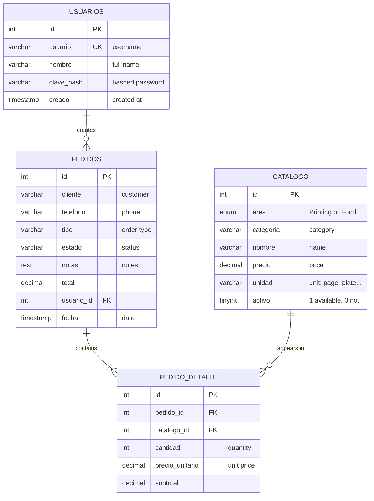
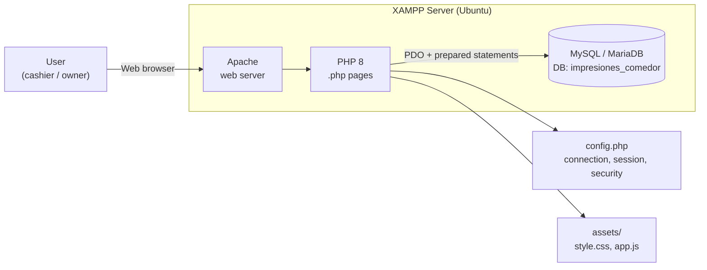
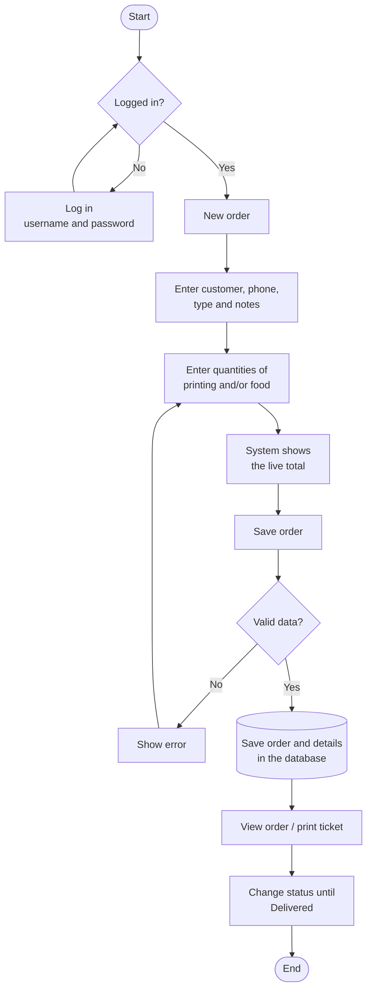
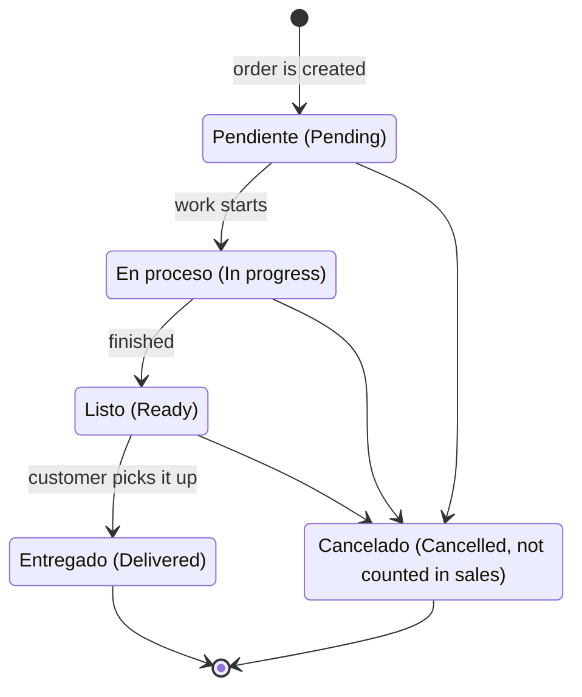
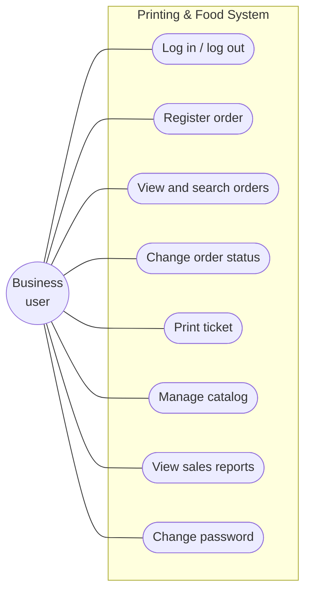
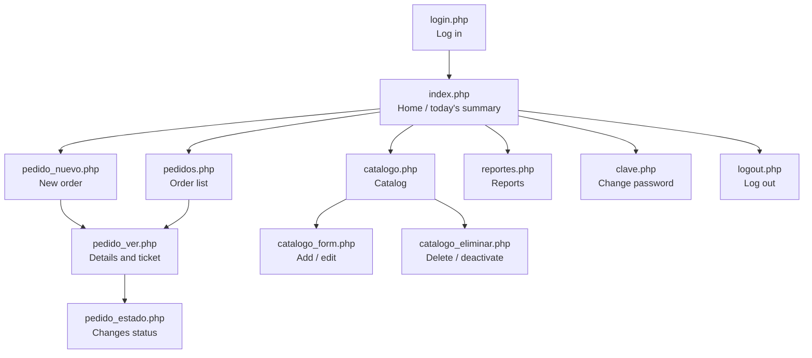

# System Diagrams
**Printing & Food System**

GitHub renders the diagrams in this file automatically (Mermaid format). PNG versions are in `docs/img/diagramas/en/` for Word documents or slides. Each diagram's source code is in `docs/diagramas/en/`.

> Database table and field names are in Spanish because that is how they appear in the code (e.g. `pedidos` = orders, `catalogo` = catalog).

---

## 1. Entity-Relationship Diagram (database)

The 4 tables of the `impresiones_comedor` database and their relationships.

Image: [`1_entity_relationship.png`](../img/diagramas/en/1_entity_relationship.png)

---

## 2. System Architecture

The user works in a web browser; Apache runs PHP; PHP reads and writes to MySQL.

Image: [`2_architecture.png`](../img/diagramas/en/2_architecture.png)

---

## 3. Flowchart: registering an order

Steps from the moment a customer arrives until the order is delivered.

Image: [`3_order_flow.png`](../img/diagramas/en/3_order_flow.png)

---

## 4. Order State Diagram

States an order goes through.

Image: [`4_order_states.png`](../img/diagramas/en/4_order_states.png)

---

## 5. Use Cases

What the user can do in the system.

Image: [`5_use_cases.png`](../img/diagramas/en/5_use_cases.png)

---

## 6. Site Map

How the system pages are connected.

Image: [`6_site_map.png`](../img/diagramas/en/6_site_map.png)
