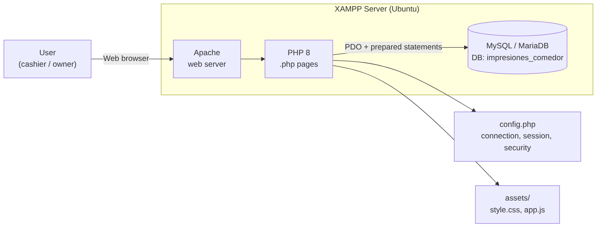
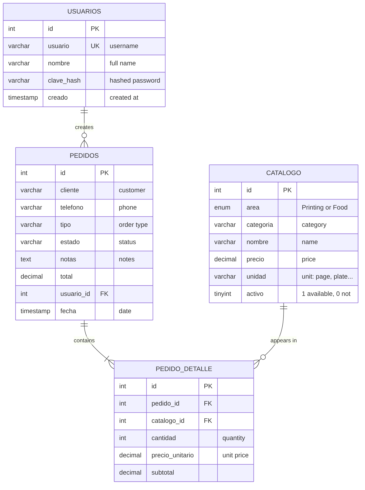
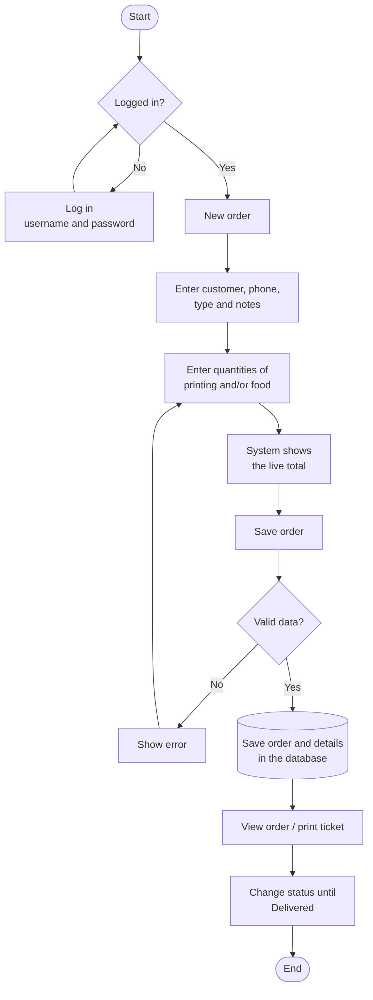

# Technical Manual
**Printing & Food System** (*Sistema de Impresiones y Comedor*) · Version 1.0

For technical staff who install, maintain or modify the system.

> Source code identifiers (files, tables, fields, constants) are in Spanish. English meanings are given where useful.

---

## 1. Overview

Web application for **order and sales management** in a business with two areas: **Impresiones** (Printing: prints, copies and services) and **Comida** (Food: lunches, breakfasts, snacks and drinks). One order can mix items from both areas.

**Modules:**

| Module | Files |
|---|---|
| Authentication | `login.php`, `logout.php`, `clave.php` (change password) |
| Dashboard (today's summary) | `index.php` |
| Orders | `pedido_nuevo.php` (new), `pedidos.php` (list), `pedido_ver.php` (view), `pedido_estado.php` (status) |
| Catalog | `catalogo.php`, `catalogo_form.php`, `catalogo_eliminar.php` |
| Reports | `reportes.php` |

---

## 2. Technology stack

| Layer | Technology |
|---|---|
| Web server | Apache 2.4 (bundled with XAMPP) |
| Server language | PHP 8.x, no framework |
| Database | MySQL 8 / MariaDB 10 (bundled with XAMPP) |
| Data access | PDO with prepared statements |
| Front end | HTML5, responsive CSS3 and plain JavaScript |
| Version control | Git / GitHub |

No Composer, npm or external libraries are required.

---

## 3. Architecture



It is a **3-tier client-server** architecture:

1. **Presentation:** the browser renders the HTML generated by PHP, styled by `assets/style.css`, with `assets/app.js` for interaction.
2. **Logic:** each `.php` file handles the request, validates input and applies the business rules.
3. **Data:** MySQL stores the information. PHP connects through PDO, configured in `config.php`.

Every page follows the same pattern:

```
require 'config.php';   → connection, session and helper functions
requiere_login();       → redirect to login.php if there is no session
[handle POST]           → check CSRF, validate, save, redirect
[query data]            → SELECT with prepared statements
require 'header.php';   → menu
[page HTML]
require 'footer.php';   → footer and JavaScript
```

---

## 4. File structure

```
impresiones/
├── config.php              Settings, PDO connection, session, CSRF and helpers
├── header.php / footer.php Shared layout (menu and footer)
├── login.php / logout.php  Log in / log out
├── index.php               Dashboard: today's sales per area and active orders
├── pedido_nuevo.php        New order form (uses a transaction)
├── pedidos.php             Order list with filters (date, status, text)
├── pedido_ver.php          Order details, printable ticket, status buttons
├── pedido_estado.php       Changes status (POST only)
├── catalogo.php            Catalog list with filters
├── catalogo_form.php       Create / edit an item
├── catalogo_eliminar.php   Deletes an item, or deactivates it if it has sales
├── reportes.php            Reports for a date range
├── clave.php               Change password
├── assets/
│   ├── style.css           Styles (including @media print for the ticket)
│   └── app.js              Live order total
├── database/
│   ├── database.sql        Database creation script with seed data
│   └── .htaccess           Blocks web access to this folder
├── docs/                   Manuals and diagrams (ES / EN)
├── .htaccess               Apache hardening (no directory listing; blocks .sql and .md)
├── .gitignore
├── LICENSE                 MIT license
└── README.md
```

---

## 5. Database

- **Name:** `impresiones_comedor`
- **Engine:** InnoDB · **Charset:** `utf8mb4_unicode_ci`
- **Script:** `database/database.sql`

### 5.1 Entity-Relationship Diagram



### 5.2 Relationships

| Relationship | Type | On delete |
|---|---|---|
| `usuarios` → `pedidos` | One to many | `ON DELETE SET NULL` (order is kept) |
| `pedidos` → `pedido_detalle` | One to many | `ON DELETE CASCADE` |
| `catalogo` → `pedido_detalle` | One to many | `ON DELETE RESTRICT` (items already sold cannot be deleted) |

### 5.3 Data dictionary

**Table `usuarios`** (users): people who can log in.

| Field | Type | Null | Description |
|---|---|---|---|
| id | INT AUTO_INCREMENT | No | Primary key |
| usuario | VARCHAR(50) UNIQUE | No | Login username |
| nombre | VARCHAR(100) | No | Full name (printed on the ticket as "Atendió", served by) |
| clave_hash | VARCHAR(255) | No | Password hashed with `password_hash()` (bcrypt) |
| creado | TIMESTAMP | No | Creation date |

**Table `catalogo`** (catalog): printing services and food items.

| Field | Type | Null | Description |
|---|---|---|---|
| id | INT AUTO_INCREMENT | No | Primary key |
| area | ENUM('Impresiones','Comida') | No | Business area |
| categoria | VARCHAR(50) | No | Category (Copies, Lunches, Drinks…) |
| nombre | VARCHAR(100) | No | Service or dish name |
| precio | DECIMAL(10,2) | No | Current unit price |
| unidad | VARCHAR(30) | No | Unit charged (page, plate…) |
| activo | TINYINT(1) | No | 1 = available, 0 = unavailable |

**Table `pedidos`** (orders): order header.

| Field | Type | Null | Description |
|---|---|---|---|
| id | INT AUTO_INCREMENT | No | Primary key (order number) |
| cliente | VARCHAR(100) | No | Customer name |
| telefono | VARCHAR(20) | Yes | Customer phone |
| tipo | VARCHAR(30) | No | To go / Eat here / Pick up later |
| estado | VARCHAR(20) | No | Pendiente / En proceso / Listo / Entregado / Cancelado |
| notas | TEXT | Yes | Special instructions |
| total | DECIMAL(10,2) | No | Sum of subtotals |
| usuario_id | INT (FK) | Yes | User who registered the order |
| fecha | TIMESTAMP | No | Order date and time |

**Table `pedido_detalle`** (order details): order lines.

| Field | Type | Null | Description |
|---|---|---|---|
| id | INT AUTO_INCREMENT | No | Primary key |
| pedido_id | INT (FK) | No | Parent order |
| catalogo_id | INT (FK) | No | Catalog item sold |
| cantidad | INT | No | Quantity |
| precio_unitario | DECIMAL(10,2) | No | **Price at the time of sale** (historical) |
| subtotal | DECIMAL(10,2) | No | quantity × unit price |

> The price is copied into `pedido_detalle.precio_unitario` when the sale is made. If the catalog price changes later, past orders and reports stay the same.

---

## 6. Business rules

1. Every order needs a **customer** and **at least one line** with a quantity greater than 0.
2. **Prices are read from the database** on the server. Prices sent by the form are ignored, so nobody can change them from the browser.
3. The order and its lines are saved in a **transaction** (`beginTransaction` / `commit` / `rollBack`): either everything is saved or nothing is.
4. **Cancelled orders are not counted** on the dashboard or in reports.
5. A catalog item **with sales cannot be deleted**. It is set to `activo = 0` instead.
6. Only items with `activo = 1` appear in the new order form.
7. Orders **cannot be edited** after saving. Cancel the order and create a new one.

### Order flow



### Statuses


---

## 7. Security

| Risk | Measure |
|---|---|
| SQL injection | All queries with user input use **PDO prepared statements** |
| XSS | All output goes through `e()` (`htmlspecialchars`) |
| Password exposure | Passwords are stored with `password_hash()` (bcrypt) and checked with `password_verify()` |
| CSRF | Every POST form carries a token checked with `hash_equals()` |
| Session fixation | `session_regenerate_id(true)` on login |
| Unauthorized access | `requiere_login()` on every internal page |
| SQL script download | `.htaccess` blocks `database/`, `docs/`, `.sql` and `.md` files |
| Directory listing | `Options -Indexes` in `.htaccess` |

**Production recommendations:**
- Change the `admin` password after installing.
- Set a password for MySQL `root`, or better, create a dedicated user:
  ```sql
  CREATE USER 'impresiones'@'localhost' IDENTIFIED BY 'AStrongPassword123';
  GRANT SELECT, INSERT, UPDATE, DELETE ON impresiones_comedor.* TO 'impresiones'@'localhost';
  ```
  Then update `DB_USER` and `DB_PASS` in `config.php`.
- Run `sudo /opt/lampp/lampp security` to secure XAMPP.

---

## 8. Configuration (`config.php`)

| Constant | Default | Description |
|---|---|---|
| `NEGOCIO` | Impresiones y Comedor | Business name on screen and ticket |
| `LUGAR` | Apopa, San Salvador | Address on the ticket |
| `DB_HOST` | localhost | MySQL server |
| `DB_NAME` | impresiones_comedor | Database |
| `DB_USER` | root | MySQL user |
| `DB_PASS` | *(empty)* | MySQL password |
| `AREAS` | Impresiones, Comida | Areas (must match the table ENUM) |
| `CATEGORIAS` | … | Category suggestions in the form |
| `TIPOS` | Para llevar, Comer aquí, Recoger después | Order types |
| `ESTADOS` | Pendiente … Cancelado | Valid statuses |

The time zone is `America/El_Salvador`. It is also applied to MySQL on connect, so "today" means the same date in PHP and in the database.

---

## 9. Maintenance

### 9.1 Database backup

```bash
/opt/lampp/bin/mysqldump -u root impresiones_comedor > backup_$(date +%F).sql
```

Automatic daily backup at 9 p.m. (`crontab -e`):
```
0 21 * * * /opt/lampp/bin/mysqldump -u root impresiones_comedor > $HOME/backups/impresiones_$(date +\%F).sql
```

### 9.2 Restore a backup

```bash
/opt/lampp/bin/mysql -u root impresiones_comedor < backup_2026-10-19.sql
```

### 9.3 Create a new user

1. Generate the password hash:
   ```bash
   /opt/lampp/bin/php -r 'echo password_hash("NewPassword123", PASSWORD_DEFAULT), "\n";'
   ```
2. Insert the user (replace the hash with the output above):
   ```sql
   INSERT INTO usuarios (usuario, nombre, clave_hash)
   VALUES ('cashier1', 'Cashier One', '$2y$10$...output...');
   ```

### 9.4 Reset a forgotten password

Generate a hash as in 9.3 and run:
```sql
UPDATE usuarios SET clave_hash = '$2y$10$...output...' WHERE usuario = 'admin';
```

### 9.5 Update from GitHub

```bash
cd /opt/lampp/htdocs/impresiones
git pull
```
*(Back up `config.php` first if you changed it.)*

---

## 10. Extending the system

| I want to… | Change |
|---|---|
| Add a new status | Add it to `ESTADOS` in `config.php` and an `.est-…` class in `style.css` |
| Add an order type | Add it to `TIPOS` in `config.php` |
| Add a third area (e.g. *Stationery*) | Change the `area` ENUM in `catalogo` and add it to `AREAS` and `CATEGORIAS` |
| Change colors | `:root` variables at the top of `assets/style.css` |

---

## 11. Tests performed

A full automated browser walkthrough checked the following:

| Test | Result |
|---|---|
| Login with wrong credentials shows an error | ✅ |
| Correct login opens the dashboard | ✅ |
| An internal page without a session redirects to login | ✅ |
| Mixed order (printing + food): live total and saved total = $6.50 | ✅ |
| An order with no items is rejected | ✅ |
| Status changes Pending → In progress → Ready | ✅ |
| A cancelled order is not counted on the dashboard or in reports | ✅ |
| Dashboard totals per area (Printing $3.50, Food $9.00, total $12.50) | ✅ |
| Order filters by status and date | ✅ |
| Adding and deleting a catalog item | ✅ |
| Deleting an item that was already sold deactivates it instead | ✅ |
| Report for a date range | ✅ |
| Password change and new login | ✅ |
| POST request without a CSRF token is rejected (HTTP 400) | ✅ |
| No PHP or JavaScript errors or warnings | ✅ |

---

## 12. More diagrams

- Use cases: `docs/img/diagramas/en/5_use_cases.png`
- Site map: `docs/img/diagramas/en/6_site_map.png`
- All diagrams with source code: see [diagrams.md](diagrams.md)
