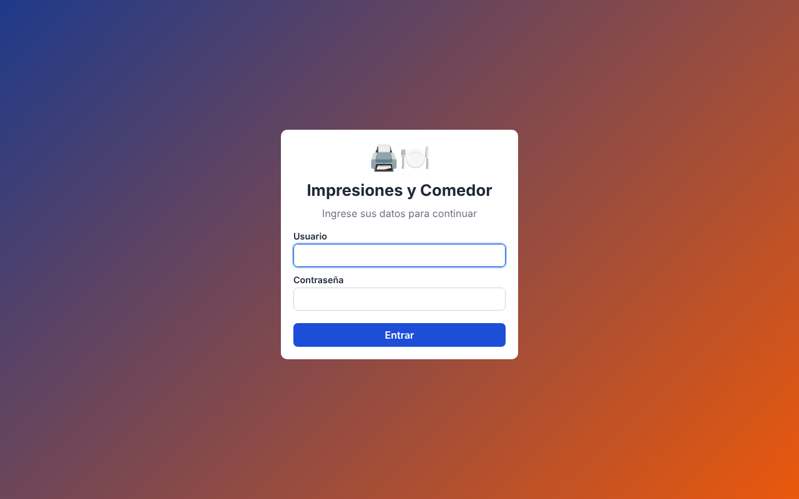
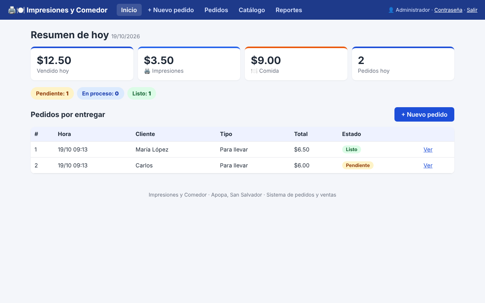
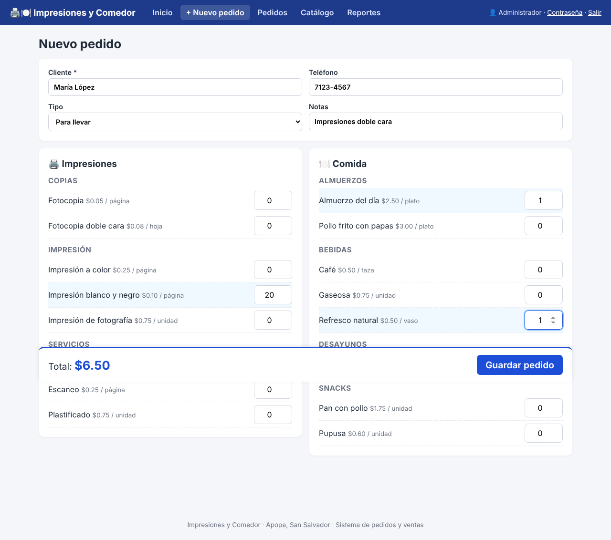
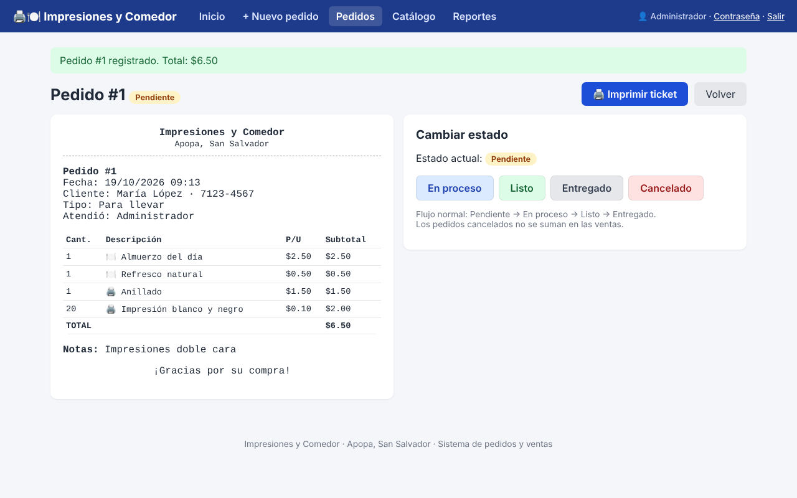
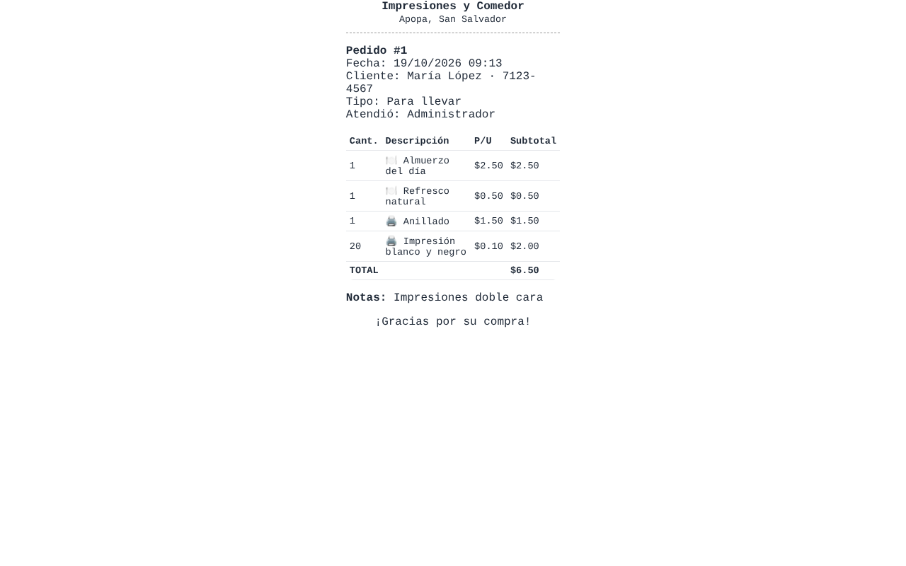
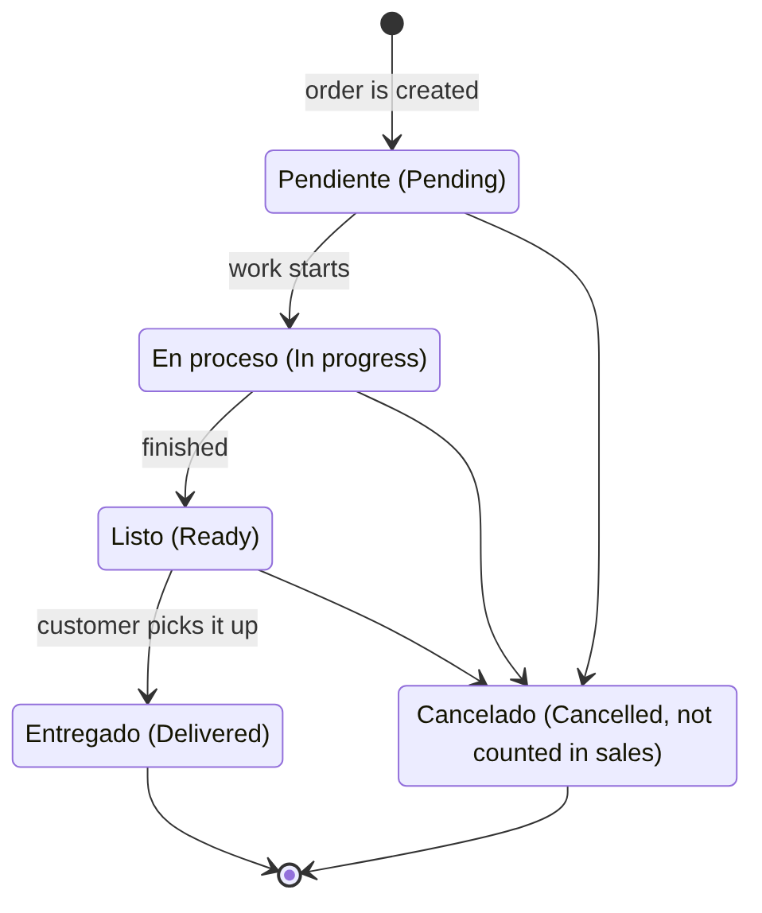
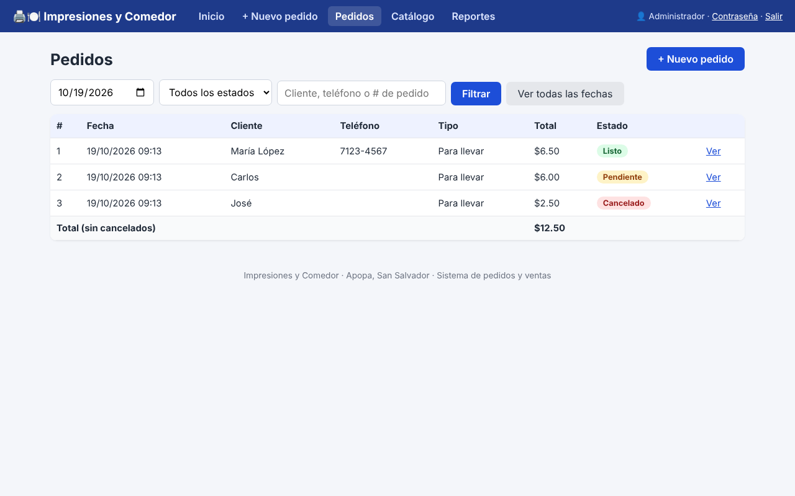
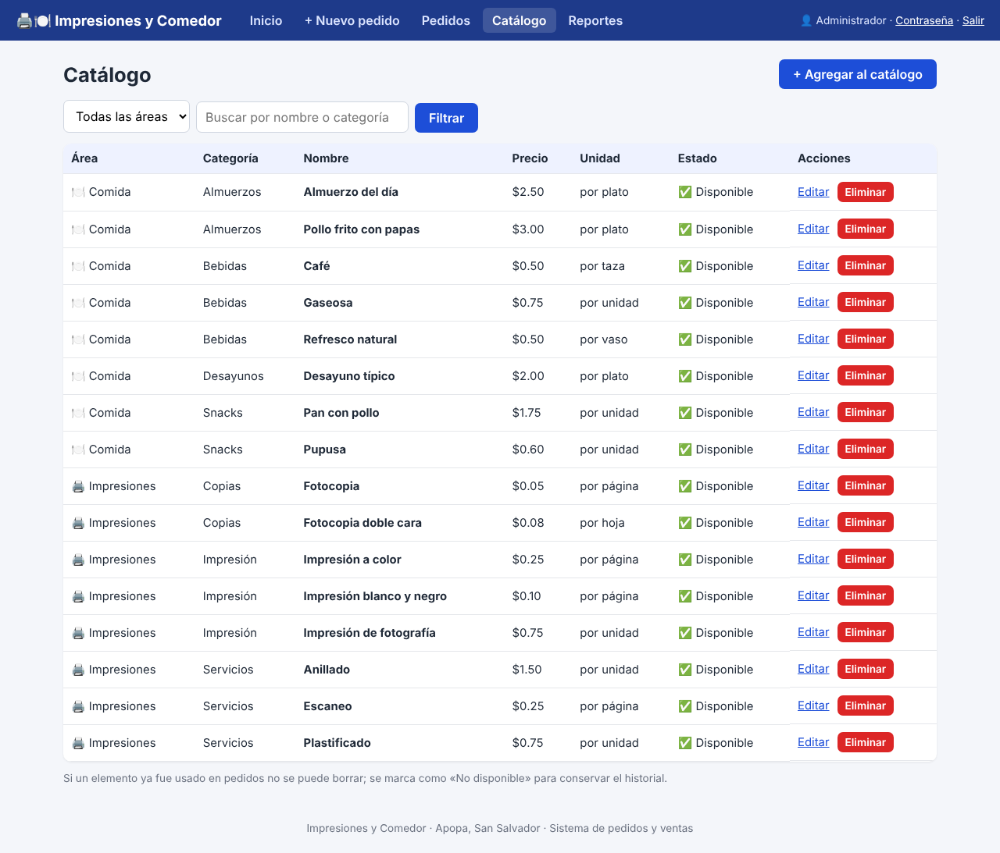
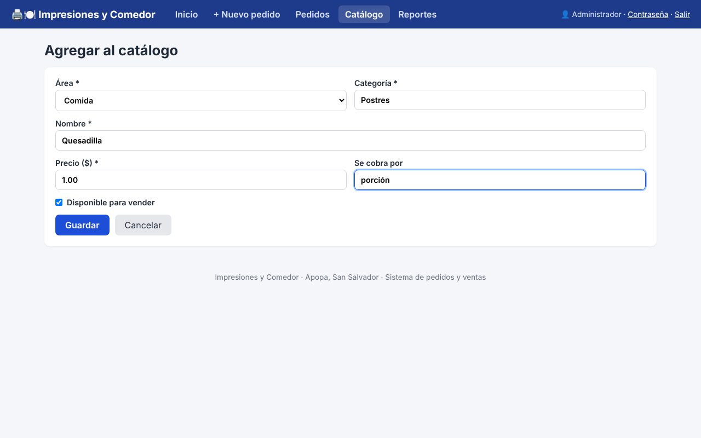
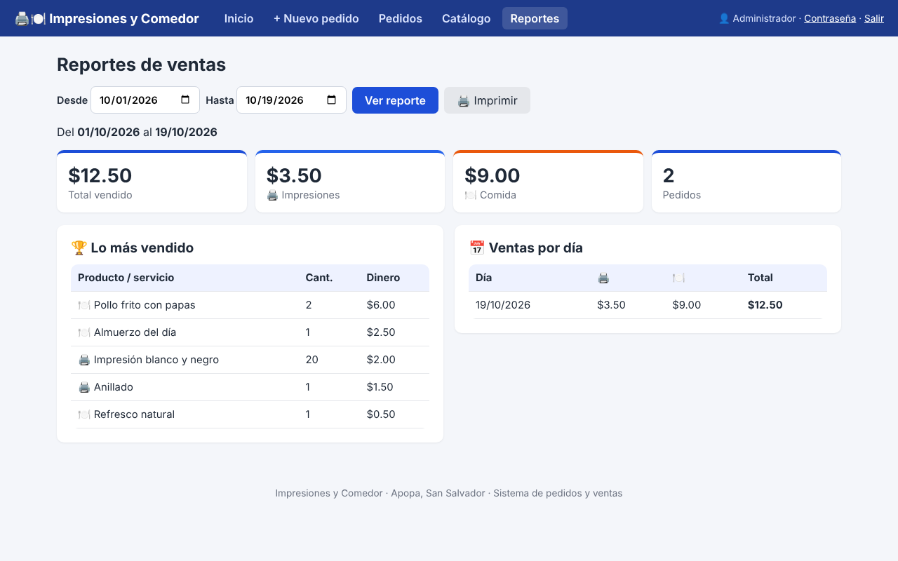

# User Manual
**Printing & Food System** (*Sistema de Impresiones y Comedor*) · Version 1.0

This manual is for the people who run the business: cashiers, staff and owners. No computer knowledge is needed.

> The system's screens are in Spanish. Each screen name is shown here with its English meaning, for example **Pedidos** (Orders).

---

## 1. What does the system do?

The business sells **two kinds of things**:

- 🖨️ **Impresiones** (Printing): black & white or color prints, copies, scans, binding, laminating…
- 🍽️ **Comida** (Food): lunches, breakfasts, snacks and drinks.

With the system you can:

- Register customer **orders**, mixing printing and food in the same order.
- See which orders are **pending, in progress or ready**.
- **Print a ticket** for the customer.
- Change **prices** and add new products or services.
- See **how much was sold** per day, per area, and the best sellers.

---

## 2. Logging in

1. Open your browser (Chrome or Firefox) and type the address you were given, for example **http://localhost/impresiones**.
2. Type your **Usuario** (username) and **Contraseña** (password).
3. Click **Entrar** (Enter).

> If the data is wrong, the message *"Usuario o contraseña incorrectos"* (wrong username or password) appears. Try again.

To **log out**, click **Salir** (top right). Always do this at the end of your shift.

---

## 3. Main menu

All options are in the blue bar at the top:

| Option | English | Purpose |
|---|---|---|
| **Inicio** | Home | Today's summary and orders to deliver |
| **+ Nuevo pedido** | New order | Register what a customer orders |
| **Pedidos** | Orders | View and search all orders |
| **Catálogo** | Catalog | View and change products, services and prices |
| **Reportes** | Reports | Sales for a date range |
| **Contraseña** | Password | Change your password |
| **Salir** | Log out | End your session |

---

## 4. Home (today's summary)

At a glance you see:

- **Vendido hoy** (Sold today): all money for the day (cancelled orders are not counted).
- **🖨️ Impresiones** and **🍽️ Comida**: how much each area made today.
- **Pedidos hoy** (Orders today): number of orders.
- Colored buttons showing how many orders are **Pendiente** (Pending), **En proceso** (In progress) and **Listo** (Ready). Click one to see those orders.
- **Pedidos por entregar** (Orders to deliver): what still needs to be delivered. **Ready** orders appear first.

---

## 5. Registering a new order

1. Click **+ Nuevo pedido**.
2. Type the **customer name** (required) and, optionally, the **phone number**.
3. Choose the **type**: *Para llevar* (to go), *Comer aquí* (eat here) or *Recoger después* (pick up later).
4. Use **Notas** (Notes) for special instructions, for example *"doble cara"* (double-sided) or *"sin cebolla"* (no onion).
5. Type the **quantity** of each item:
   - **Printing** is on the left.
   - **Food** is on the right.
   - Lines with a quantity are highlighted in light blue.
6. The **Total** is calculated automatically at the bottom.
7. Click **Guardar pedido** (Save order).

**Example:** María orders 20 black & white prints, one binding, one lunch and one fresh drink. Total: **$6.50**.

> If you leave out the customer name or every quantity is 0, the system warns you and does not save the order.

---

## 6. Viewing an order and printing the ticket

After saving, the order details open:

- On the **left** is the **ticket**, with everything the customer ordered and the total.
- On the **right** are the buttons to **change the status**.

### Print the ticket
Click **🖨️ Imprimir ticket** (Print ticket). Only the ticket is printed, without menus or buttons. It works with regular printers and with 80 mm receipt printers.

---

## 7. Order statuses

Each order goes through these steps:

| Status | Meaning | Color |
|---|---|---|
| **Pendiente** (Pending) | Just registered, not started yet | 🟡 Yellow |
| **En proceso** (In progress) | Being printed or cooked | 🔵 Blue |
| **Listo** (Ready) | Finished, waiting for pickup | 🟢 Green |
| **Entregado** (Delivered) | The customer has taken it | ⚪ Gray |
| **Cancelado** (Cancelled) | The customer no longer wants it. **Not counted** in sales | 🔴 Red |

To change it, open the order and click the button for the new status. **Cancelado** asks for confirmation first.

---

## 8. Searching orders

Click **Pedidos** (Orders).

- By default you see **today's** orders.
- Change the **date** to see another day, or click **Ver todas las fechas** (show all dates).
- Filter by **status** (for example, only *Listo*).
- Search by **customer name**, **phone** or **order number**.
- Below the table is the **total** of the orders shown (cancelled orders not included).
- Click **Ver** (View) to open an order.

---

## 9. Catalog (products, services and prices)

Click **Catálogo** (Catalog).

### Add something new
1. Click **+ Agregar al catálogo** (Add to catalog).
2. Choose the **area**: *Impresiones* (Printing) or *Comida* (Food).
3. Type the **category** (for example *Copias*, *Almuerzos* or *Bebidas*). Pick one from the list or type a new one.
4. Type the **name** and **price**.
5. In **Se cobra por** (Charged per) type the unit: *página* (page), *plato* (plate), *unidad* (unit)…
6. Leave **Disponible para vender** (Available for sale) checked.
7. Click **Guardar** (Save).

### Change a price
Click **Editar** (Edit) on the row, change the price and click **Guardar**. Previous orders **keep the price they were sold at**.

### Remove something from the menu for a day
Click **Editar** and uncheck **Disponible para vender**. It will no longer appear in *Nuevo pedido*, but it is not deleted.

### Delete
Click **Eliminar** (Delete). If the item has already been sold, the system **does not delete it**. It marks it as *No disponible* (unavailable) so the sales history is kept.

---

## 10. Sales reports

Click **Reportes** (Reports).

1. Choose the **Desde** (From) and **Hasta** (To) dates. The current month is shown by default.
2. Click **Ver reporte** (View report).

The report shows:
- **Total vendido** (Total sold), each area's total and the number of orders.
- **🏆 Lo más vendido** (Best sellers): the top 10 items by money earned.
- **📅 Ventas por día** (Sales per day): each day's sales, split into Printing and Food.

Click **🖨️ Imprimir** (Print) to get it on paper or save it as a PDF.

---

## 11. Changing your password

1. Click **Contraseña** (top right).
2. Type your current password.
3. Type the new password twice. It needs **at least 6 characters**.
4. Click **Guardar** (Save).

---

## 12. Serving a customer: quick summary

1. **+ Nuevo pedido** → name → quantities → **Guardar pedido**.
2. **🖨️ Imprimir ticket** and take payment.
3. When work starts: **En proceso**.
4. When finished: **Listo**.
5. When the customer takes it: **Entregado**.

---

## 13. Frequently asked questions

**Can I use it on my phone?**
Yes. If the phone is on the same Wi-Fi network, open the address your manager gives you (for example `http://192.168.1.25/impresiones`).

**I made a mistake in an order. Can I edit it?**
No, so that nobody can change an order that was already paid. Mark it as **Cancelado** and create a new one.

**Is the information lost if I turn off the computer?**
No. Everything is saved in the database. When you turn it back on, start XAMPP and keep working.

**I forgot my password.**
Ask the technical staff to reset it (see the *Technical Manual*).
