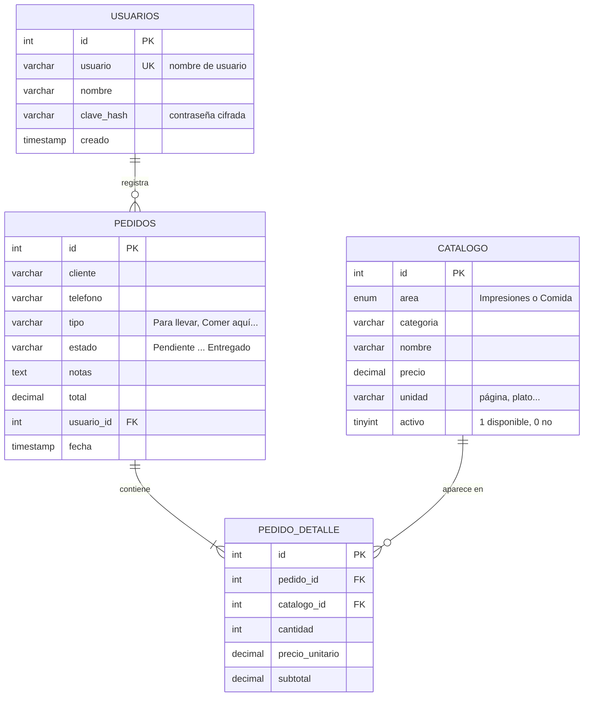
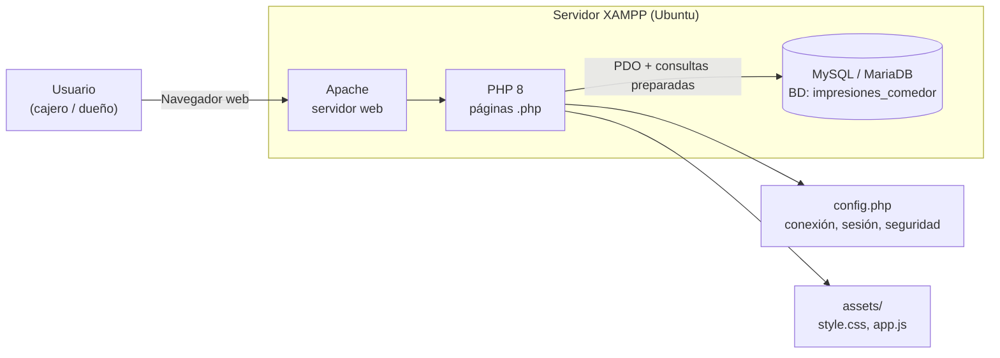
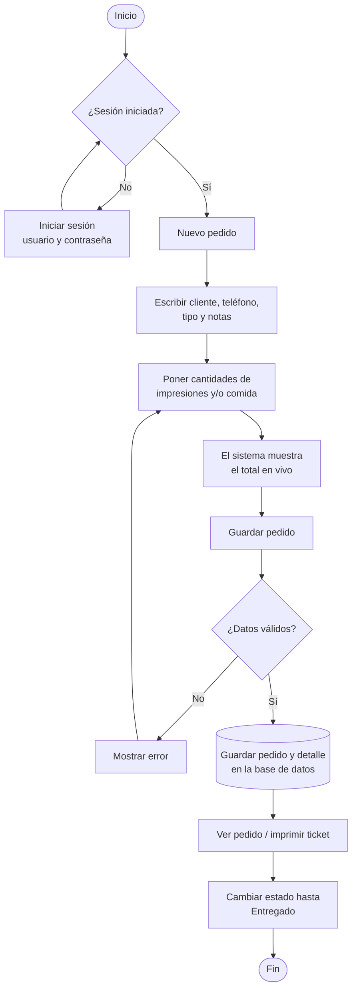
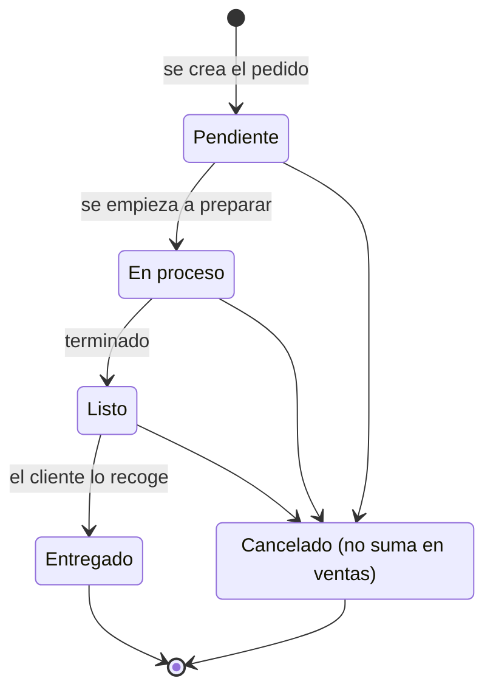
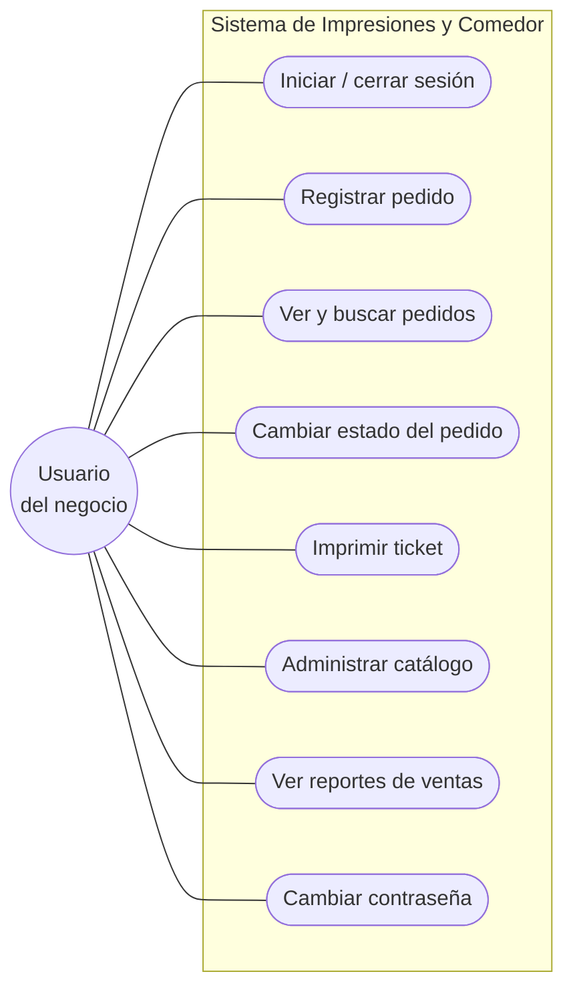
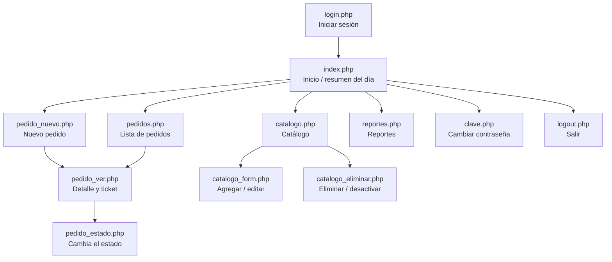

# Diagramas del sistema
**Sistema de Impresiones y Comedor**

GitHub dibuja automáticamente los diagramas de este archivo (formato Mermaid). Las versiones en imagen PNG están en `docs/img/diagramas/es/` para pegarlas en Word o en presentaciones. El código fuente de cada diagrama está en `docs/diagramas/es/`.

---

## 1. Diagrama Entidad-Relación (base de datos)

Muestra las 4 tablas de la base de datos `impresiones_comedor` y cómo se relacionan.

Imagen: [`1_entidad_relacion.png`](../img/diagramas/es/1_entidad_relacion.png)

---

## 2. Arquitectura del sistema

El usuario usa el navegador; Apache ejecuta PHP; PHP lee y guarda en MySQL.

Imagen: [`2_arquitectura.png`](../img/diagramas/es/2_arquitectura.png)

---

## 3. Diagrama de flujo: registrar un pedido

Pasos desde que llega el cliente hasta que se entrega el pedido.

Imagen: [`3_flujo_pedido.png`](../img/diagramas/es/3_flujo_pedido.png)

---

## 4. Diagrama de estados del pedido

Estados por los que pasa un pedido.

Imagen: [`4_estados_pedido.png`](../img/diagramas/es/4_estados_pedido.png)

---

## 5. Casos de uso

Lo que el usuario puede hacer en el sistema.

Imagen: [`5_casos_de_uso.png`](../img/diagramas/es/5_casos_de_uso.png)

---

## 6. Mapa de navegación

Cómo se conectan las páginas del sistema.

Imagen: [`6_mapa_navegacion.png`](../img/diagramas/es/6_mapa_navegacion.png)
