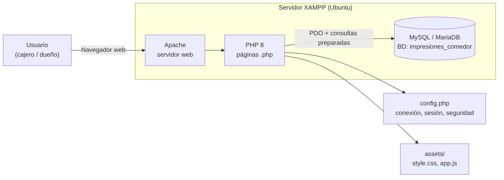
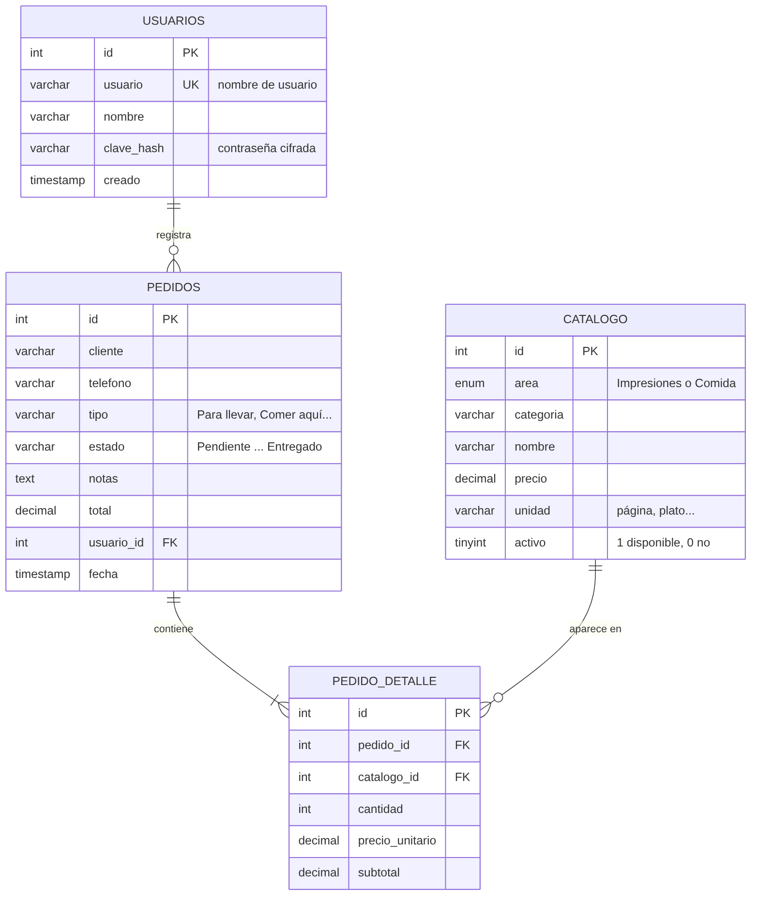
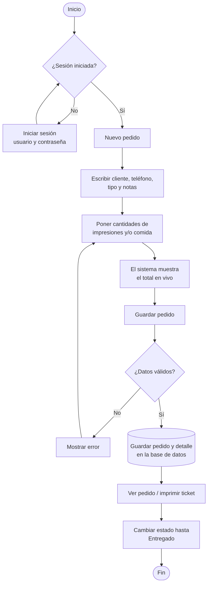
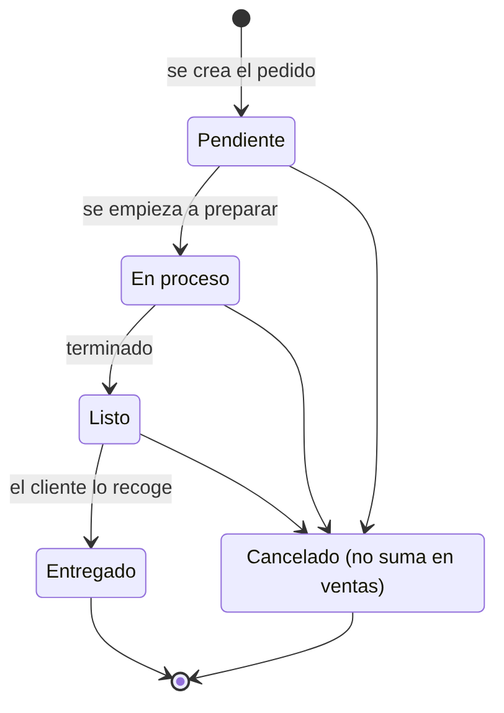

# Manual Técnico
**Sistema de Impresiones y Comedor** · Versión 1.0

Documento para el personal técnico que instala, mantiene o modifica el sistema.

---

## 1. Descripción general

Aplicación web de **gestión de pedidos y ventas** para un negocio con dos áreas: **Impresiones** (impresiones, copias y servicios) y **Comida** (almuerzos, desayunos, snacks y bebidas). Un mismo pedido puede combinar elementos de las dos áreas.

**Módulos:**

| Módulo | Archivos |
|---|---|
| Autenticación | `login.php`, `logout.php`, `clave.php` |
| Panel (resumen del día) | `index.php` |
| Pedidos | `pedido_nuevo.php`, `pedidos.php`, `pedido_ver.php`, `pedido_estado.php` |
| Catálogo | `catalogo.php`, `catalogo_form.php`, `catalogo_eliminar.php` |
| Reportes | `reportes.php` |

---

## 2. Tecnologías

| Capa | Tecnología |
|---|---|
| Servidor web | Apache 2.4 (incluido en XAMPP) |
| Lenguaje del servidor | PHP 8.x, sin frameworks |
| Base de datos | MySQL 8 / MariaDB 10 (incluido en XAMPP) |
| Acceso a datos | PDO con consultas preparadas |
| Interfaz | HTML5, CSS3 (responsive) y JavaScript puro |
| Control de versiones | Git / GitHub |

No necesita Composer, npm ni librerías externas.

---

## 3. Arquitectura



Es una arquitectura **cliente-servidor de 3 capas**:

1. **Presentación:** el navegador muestra las páginas HTML que genera PHP, con los estilos de `assets/style.css` y el script `assets/app.js`.
2. **Lógica:** cada archivo `.php` recibe la petición, valida los datos y aplica las reglas del negocio.
3. **Datos:** MySQL guarda la información. PHP se conecta mediante PDO, configurado en `config.php`.

Cada página sigue el mismo patrón:

```
require 'config.php';   → conexión, sesión y funciones de ayuda
requiere_login();       → si no hay sesión, envía a login.php
[procesar POST]         → validar CSRF, validar datos, guardar, redirigir
[consultar datos]       → SELECT con consultas preparadas
require 'header.php';   → menú
[HTML de la página]
require 'footer.php';   → pie y JavaScript
```

---

## 4. Estructura de archivos

```
impresiones/
├── config.php              Configuración, conexión PDO, sesión, CSRF y funciones de ayuda
├── header.php / footer.php Plantilla común (menú y pie)
├── login.php / logout.php  Inicio y cierre de sesión
├── index.php               Panel: ventas del día por área y pedidos activos
├── pedido_nuevo.php        Formulario de pedido (con transacción)
├── pedidos.php             Lista de pedidos con filtros (fecha, estado, texto)
├── pedido_ver.php          Detalle, ticket imprimible y botones de estado
├── pedido_estado.php       Cambia el estado (solo POST)
├── catalogo.php            Lista del catálogo con filtros
├── catalogo_form.php       Crear / editar un elemento
├── catalogo_eliminar.php   Elimina, o desactiva si ya tiene ventas
├── reportes.php            Reportes por rango de fechas
├── clave.php               Cambio de contraseña
├── assets/
│   ├── style.css           Estilos (incluye @media print para el ticket)
│   └── app.js              Total en vivo del pedido
├── database/
│   ├── database.sql        Script de creación de la BD con datos iniciales
│   └── .htaccess           Bloquea el acceso web a la carpeta
├── docs/                   Manuales y diagramas (ES / EN)
├── .htaccess               Seguridad de Apache (sin listado; bloquea .sql y .md)
├── .gitignore
├── LICENSE                 Licencia MIT
└── README.md
```

---

## 5. Base de datos

- **Nombre:** `impresiones_comedor`
- **Motor:** InnoDB · **Juego de caracteres:** `utf8mb4_unicode_ci`
- **Script:** `database/database.sql`

### 5.1 Diagrama Entidad-Relación



### 5.2 Relaciones

| Relación | Tipo | Regla al borrar |
|---|---|---|
| `usuarios` → `pedidos` | 1 a muchos | `ON DELETE SET NULL` (el pedido se conserva) |
| `pedidos` → `pedido_detalle` | 1 a muchos | `ON DELETE CASCADE` |
| `catalogo` → `pedido_detalle` | 1 a muchos | `ON DELETE RESTRICT` (no se borra lo ya vendido) |

### 5.3 Diccionario de datos

**Tabla `usuarios`**: personas que pueden entrar al sistema.

| Campo | Tipo | Nulo | Descripción |
|---|---|---|---|
| id | INT AUTO_INCREMENT | No | Llave primaria |
| usuario | VARCHAR(50) UNIQUE | No | Nombre para iniciar sesión |
| nombre | VARCHAR(100) | No | Nombre completo (se ve en el ticket como "Atendió") |
| clave_hash | VARCHAR(255) | No | Contraseña cifrada con `password_hash()` (bcrypt) |
| creado | TIMESTAMP | No | Fecha de creación |

**Tabla `catalogo`**: servicios de impresión y platillos.

| Campo | Tipo | Nulo | Descripción |
|---|---|---|---|
| id | INT AUTO_INCREMENT | No | Llave primaria |
| area | ENUM('Impresiones','Comida') | No | Área del negocio |
| categoria | VARCHAR(50) | No | Agrupación (Copias, Almuerzos, Bebidas…) |
| nombre | VARCHAR(100) | No | Nombre del servicio o platillo |
| precio | DECIMAL(10,2) | No | Precio actual por unidad |
| unidad | VARCHAR(30) | No | Unidad de cobro (página, plato…) |
| activo | TINYINT(1) | No | 1 = disponible, 0 = no disponible |

**Tabla `pedidos`**: encabezado de cada pedido.

| Campo | Tipo | Nulo | Descripción |
|---|---|---|---|
| id | INT AUTO_INCREMENT | No | Llave primaria (número de pedido) |
| cliente | VARCHAR(100) | No | Nombre del cliente |
| telefono | VARCHAR(20) | Sí | Teléfono del cliente |
| tipo | VARCHAR(30) | No | Para llevar / Comer aquí / Recoger después |
| estado | VARCHAR(20) | No | Pendiente / En proceso / Listo / Entregado / Cancelado |
| notas | TEXT | Sí | Indicaciones especiales |
| total | DECIMAL(10,2) | No | Suma de los subtotales |
| usuario_id | INT (FK) | Sí | Usuario que registró el pedido |
| fecha | TIMESTAMP | No | Fecha y hora del pedido |

**Tabla `pedido_detalle`**: líneas de cada pedido.

| Campo | Tipo | Nulo | Descripción |
|---|---|---|---|
| id | INT AUTO_INCREMENT | No | Llave primaria |
| pedido_id | INT (FK) | No | Pedido al que pertenece |
| catalogo_id | INT (FK) | No | Elemento del catálogo vendido |
| cantidad | INT | No | Cantidad |
| precio_unitario | DECIMAL(10,2) | No | **Precio al momento de la venta** (histórico) |
| subtotal | DECIMAL(10,2) | No | cantidad × precio_unitario |

> El precio se copia a `pedido_detalle.precio_unitario` al vender. Así, si después cambia el precio en el catálogo, los pedidos y reportes anteriores no cambian.

---

## 6. Reglas de negocio

1. Todo pedido necesita **cliente** y **al menos una línea** con cantidad mayor que 0.
2. Los **precios se leen de la base de datos** en el servidor. Los precios del formulario no se usan, para que nadie pueda cambiarlos desde el navegador.
3. El pedido y su detalle se guardan en una **transacción** (`beginTransaction` / `commit` / `rollBack`): se guarda todo o no se guarda nada.
4. Los pedidos **Cancelados no se suman** en el panel ni en los reportes.
5. Un elemento del catálogo **con ventas no se borra**: se cambia a `activo = 0`.
6. Solo los elementos `activo = 1` aparecen en *Nuevo pedido*.
7. Los pedidos **no se editan** después de guardados. Se cancelan y se crea uno nuevo.

### Flujo de un pedido



### Estados



---

## 7. Seguridad

| Riesgo | Medida aplicada |
|---|---|
| Inyección SQL | Todas las consultas con datos del usuario usan **consultas preparadas PDO** |
| XSS (código malicioso en pantalla) | Todo lo que se muestra pasa por la función `e()` (`htmlspecialchars`) |
| Contraseñas expuestas | Se guardan con `password_hash()` (bcrypt) y se verifican con `password_verify()` |
| CSRF (formularios falsos) | Todos los formularios POST llevan un token que se verifica con `hash_equals()` |
| Robo de sesión | `session_regenerate_id(true)` al iniciar sesión |
| Acceso sin permiso | `requiere_login()` en todas las páginas internas |
| Descarga del script SQL | `.htaccess` bloquea `database/`, `docs/` y los archivos `.sql` y `.md` |
| Listado de carpetas | `Options -Indexes` en `.htaccess` |

**Recomendaciones para producción:**
- Cambiar la contraseña de `admin` al instalar.
- Ponerle contraseña al usuario `root` de MySQL, o mejor, crear un usuario exclusivo:
  ```sql
  CREATE USER 'impresiones'@'localhost' IDENTIFIED BY 'UnaClaveSegura123';
  GRANT SELECT, INSERT, UPDATE, DELETE ON impresiones_comedor.* TO 'impresiones'@'localhost';
  ```
  Luego actualizar `DB_USER` y `DB_PASS` en `config.php`.
- Ejecutar `sudo /opt/lampp/lampp security` para asegurar XAMPP.

---

## 8. Configuración (`config.php`)

| Constante | Valor por defecto | Descripción |
|---|---|---|
| `NEGOCIO` | Impresiones y Comedor | Nombre en pantalla y ticket |
| `LUGAR` | Apopa, San Salvador | Dirección en el ticket |
| `DB_HOST` | localhost | Servidor MySQL |
| `DB_NAME` | impresiones_comedor | Base de datos |
| `DB_USER` | root | Usuario MySQL |
| `DB_PASS` | *(vacío)* | Contraseña MySQL |
| `AREAS` | Impresiones, Comida | Áreas (deben coincidir con el ENUM de la tabla) |
| `CATEGORIAS` | … | Sugerencias de categoría en el formulario |
| `TIPOS` | Para llevar, Comer aquí, Recoger después | Tipos de pedido |
| `ESTADOS` | Pendiente … Cancelado | Estados válidos |

La zona horaria es `America/El_Salvador` y se aplica también a MySQL al conectar, para que "hoy" sea igual en PHP y en la base de datos.

---

## 9. Mantenimiento

### 9.1 Respaldo de la base de datos

```bash
/opt/lampp/bin/mysqldump -u root impresiones_comedor > respaldo_$(date +%F).sql
```

Respaldo automático todos los días a las 9 p. m. (`crontab -e`):
```
0 21 * * * /opt/lampp/bin/mysqldump -u root impresiones_comedor > $HOME/respaldos/impresiones_$(date +\%F).sql
```

### 9.2 Restaurar un respaldo

```bash
/opt/lampp/bin/mysql -u root impresiones_comedor < respaldo_2026-10-19.sql
```

### 9.3 Crear un usuario nuevo

1. Genere la contraseña cifrada:
   ```bash
   /opt/lampp/bin/php -r 'echo password_hash("ClaveNueva123", PASSWORD_DEFAULT), "\n";'
   ```
2. Insértelo (reemplace el hash por el resultado anterior):
   ```sql
   INSERT INTO usuarios (usuario, nombre, clave_hash)
   VALUES ('cajero1', 'Cajero Uno', '$2y$10$...resultado...');
   ```

### 9.4 Restablecer una contraseña olvidada

Genere un hash como en 9.3 y ejecute:
```sql
UPDATE usuarios SET clave_hash = '$2y$10$...resultado...' WHERE usuario = 'admin';
```

### 9.5 Actualizar el sistema desde GitHub

```bash
cd /opt/lampp/htdocs/impresiones
git pull
```
*(Respalde antes `config.php` si lo modificó.)*

---

## 10. Cómo extender el sistema

| Quiero… | Qué cambiar |
|---|---|
| Agregar un estado nuevo | Agregarlo a `ESTADOS` en `config.php` y una clase `.est-…` en `style.css` |
| Agregar un tipo de pedido | Agregarlo a `TIPOS` en `config.php` |
| Agregar una tercera área (ej. *Papelería*) | Modificar el ENUM `area` en la tabla `catalogo` y agregarla a `AREAS` y `CATEGORIAS` |
| Cambiar colores | Variables `:root` al inicio de `assets/style.css` |

---

## 11. Pruebas realizadas

Se hizo un recorrido automático completo en el navegador, que verificó:

| Prueba | Resultado |
|---|---|
| Login con datos incorrectos muestra error | ✅ |
| Login correcto entra al panel | ✅ |
| Página interna sin sesión redirige al login | ✅ |
| Pedido mixto (impresiones + comida): total en vivo y total guardado = $6.50 | ✅ |
| Pedido sin productos es rechazado | ✅ |
| Cambio de estados Pendiente → En proceso → Listo | ✅ |
| Pedido cancelado no se suma en el panel ni en los reportes | ✅ |
| Totales del panel por área (Impresiones $3.50, Comida $9.00, total $12.50) | ✅ |
| Filtros de pedidos por estado y fecha | ✅ |
| Alta y eliminación de un elemento del catálogo | ✅ |
| Eliminar un elemento ya vendido lo desactiva en lugar de borrarlo | ✅ |
| Reporte por rango de fechas | ✅ |
| Cambio de contraseña y nuevo login | ✅ |
| Petición POST sin token CSRF es rechazada (HTTP 400) | ✅ |
| Sin errores ni avisos de PHP ni de JavaScript | ✅ |

---

## 12. Diagramas adicionales

- Casos de uso: `docs/img/diagramas/es/5_casos_de_uso.png`
- Mapa de navegación: `docs/img/diagramas/es/6_mapa_navegacion.png`
- Todos los diagramas con su código fuente: ver [diagramas.md](diagramas.md)
